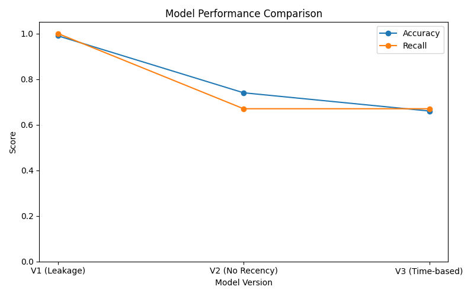
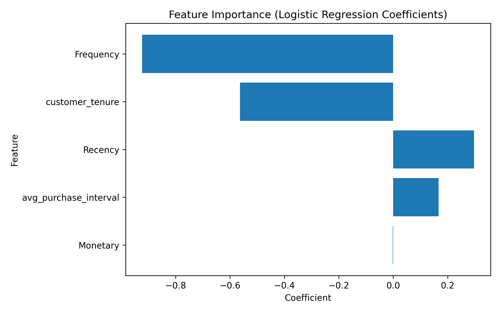
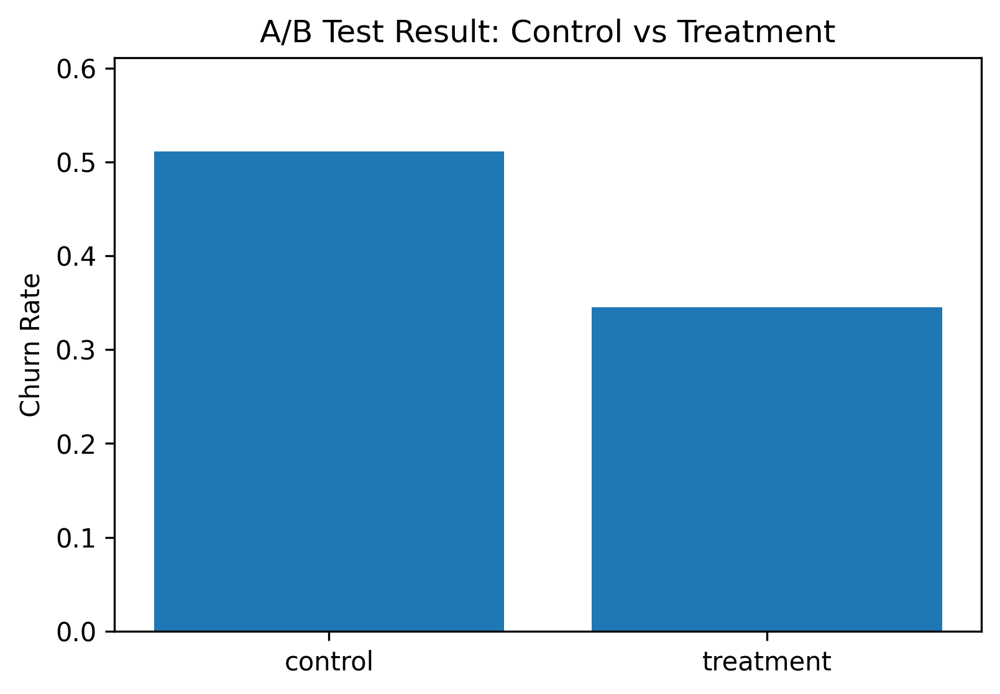

# 📊 AI 기반 고객 이탈 예측 분석

## 📌 프로젝트 개요

고객 이탈은 리테일 비즈니스에서 가장 큰 비용 문제 중 하나입니다.
신규 고객을 유치하는 비용은 기존 고객을 유지하는 것보다 훨씬 크다고 알려져 있습니다.
따라서 이탈 징후를 사전에 감지하는 것이 비즈니스 지속성에 매우 중요합니다.

이 프로젝트는 원시 트랜잭션 데이터에서 시작해 모델 기반 리텐션 전략까지 이어지는
end-to-end 이탈 예측 파이프라인을 구축하고, A/B 테스트 시뮬레이션으로 효과를 평가합니다
(관찰된 효과는 표본 부족으로 통계적으로 유의하지 않았습니다).

**핵심 포인트:** 개발 과정에서 데이터 누수(Data Leakage) 문제(정확도 ~0.99)를
직접 발견하고, 시계열 기반 데이터셋 재설계를 통해 해결했습니다.

---

## ⚡ 핵심 성과

- **데이터 누수 발견 및 해결** — 정확도 0.99 → 0.68로 재설계 (시계열 기반)
- **5-fold CV 공정 비교**로 Random Forest의 Recall 우위가 모델 성능이 아닌 클래스 가중치 효과임을 규명 (ROC-AUC 동등) — 가중치 없는 LR도 판정 기준을 0.4337로 낮추면 balanced와 같은 Recall에 도달하고 확률 보정은 더 정확함을 확인하여, 확률 보정과 해석 가능성을 근거로 **Logistic Regression**(가중치 없음) 유지
- **CLV 가중 타겟팅 도입** (expected_loss = 이탈확률 × CLV) — 저위험·고가치 고객이 진짜 위험 고객을 밀어내는 타겟팅 버그를 발견하고 수정
- **실험 설계 관점의 검정력 사전 산정** — 이탈 확률 8%p 감소 효과를 가정하면 현재 표본(45 / 58명)의 검정력은 12.7%에 불과하며, 80% 검정력 확보에는 그룹당 610명이 필요함을 산정 (A/B 시뮬레이션 p=0.0896은 이 검정력에서 예상되는 결과)
- 원시 데이터에서 비즈니스 의사결정 평가까지 전체 파이프라인 구현, 8%p 효과 가정 시 손익분기 1인당 비용(£381, 마진 미반영 매출 기준 상한) 산정 포함

---

## 🎯 분석 목적

* 이탈 가능성이 높은 고객을 사전에 탐지하여 선제적 개입 가능하도록 함
* 이탈 예측에 가장 유효한 행동 신호 파악 (최근성, 구매 빈도, 구매 간격 등)
* 위험 등급별 리텐션 예산 우선순위 설정 (매우 높음 / 높음 / 보통 / 낮음)
* 모델 기반 타겟팅이 미조치 대비 이탈률을 실제로 낮추는지 A/B 시뮬레이션으로 검증

---

## 📂 데이터셋

* **Online Retail Dataset**
* 출처: UCI Machine Learning Repository
* 트랜잭션 단위 고객 구매 데이터

원본 데이터셋은 이 저장소에 포함되어 있지 않습니다.

---

## 🏗️ 프로젝트 파이프라인

```text
원시 데이터
→ 데이터 전처리
→ 피처 엔지니어링
→ 이탈 레이블 생성
→ 모델 학습
→ 이탈 예측
→ 위험 세그멘테이션
→ 리텐션 전략 수립
→ A/B 테스트 시뮬레이션
```

---

## ⚙️ 데이터 처리

### 1. 데이터 전처리

* CustomerID 누락 행 제거
* 유효하지 않은 트랜잭션 필터링 (Quantity ≤ 0, UnitPrice ≤ 0)
* InvoiceDate를 datetime 형식으로 변환
* Sales 피처 생성

**출력 파일:**

```
data/processed/cleaned_retail.csv
```

---

### 2. 피처 엔지니어링

고객 단위 피처를 생성했습니다:

* Recency (최근성)
* Frequency (구매 빈도)
* Monetary (구매 금액)
* customer_tenure (고객 기간)
* avg_purchase_interval (평균 구매 간격)

**출력 파일:**

```
data/processed/customer_features.csv
```

---

## ⚠️ 초기 접근 방식과 문제점 (데이터 누수)

초기 이탈 정의:

```
Recency > 90 → churn = 1
```

그런데 **Recency가 입력 피처로도 사용**되어 데이터 누수가 발생했습니다.

### 결과:

* 정확도 ≈ 0.99 ~ 1.00
* 비현실적으로 완벽한 예측

검증을 위해 Recency를 피처에서 제거하고 재학습:

* 정확도가 ~0.74로 하락

모델이 실제 패턴을 학습한 것이 아니라 누수에 의존하고 있었음을 확인했습니다.

---

## 🔁 해결 방법: 시계열 기반 데이터 설계

### 핵심 아이디어

```
과거 데이터 → 피처 생성  
미래 데이터 → 이탈 레이블 생성
```

---

### Step 1: 스냅샷 날짜 정의

```
snapshot_date = 2011-09-01
```

---

### Step 2: 데이터 분리

* 과거 데이터 → 피처 생성에 사용
* 미래 데이터 → 이탈 레이블 생성에 사용

```
data/processed/past_data.csv
data/processed/future_data.csv
```

---

### Step 3: 과거 데이터 기반 피처 생성

```
data/processed/past_customer_features.csv
```

---

### Step 4: 미래 기반 이탈 레이블 생성

스냅샷 날짜 이후 90일 내에 구매가 없는 고객을 이탈로 정의합니다.

초기 버전(`create_churn_label.py`)은 데이터 누수가 포함된 베이스라인 실험에 사용되었습니다.
최종 파이프라인은 `create_future_churn_label.py`를 사용하여 누수 없는 시계열 레이블을 생성합니다.

```
data/processed/time_based_labeled_dataset.csv
```

---

## 🤖 모델 학습

### 사용 모델

* Logistic Regression : StandardScaler 적용 (거리 기반 모델)
* Random Forest : 스케일링 없음 (트리기반 모델, 스케일 불변), 튜닝 파라미터 max_depth=5, min_samples_leaf=20

---

## 📊 모델 비교

| 버전 | 설정                                  | 정확도   | Recall (이탈) | 비고            |
| ---- | ------------------------------------- | -------- | ------------- | --------------- |
| V1   | Recency 기반 레이블 + Recency 피처    | ~0.99    | ~1.00         | 데이터 누수     |
| V2   | Recency 기반 레이블, Recency 피처 제거 | ~0.74    | ~0.67         | 검증 단계       |
| V3   | 시계열 기반 데이터셋                  | **0.68** | **0.72**      | 현실적인 모델   |



---

## 📈 최종 결과

### Logistic Regression

* 정확도: **0.68**
* Recall (이탈): **0.72**
* ROC-AUC: **0.74**

### Random Forest

* 정확도: **0.68**
* Recall (이탈): **0.78**
* ROC-AUC: **0.74**
* 튜닝 파라미터 max_depth=5, min_samples_leaf=20 — 과적합 점검: Train Accuracy 0.70 vs Test Accuracy 0.68

최종 모델은 가중치 없는 Logistic Regression을 유지했습니다. 튜닝 후 Random Forest의 홀드아웃 Recall이 더 높았지만(0.78 vs 0.72), 5-fold CV로 공정하게 비교한 결과 이 차이는 모델 성능이 아니라 클래스 가중치에서 온 것이었습니다. 5-fold CV에서는 Logistic Regression(balanced)의 Recall이 0.79로 가장 높았지만, ROC-AUC는 모든 모델이 동등했습니다(0.737~0.743).

테스트 세트에서 가중치 없는 LR의 판정 기준을 0.4337로 낮추면 Recall 0.8131 / Precision 0.5817 / Accuracy 0.6642로, balanced(@0.5)와 동일했습니다. 즉 가중치의 효과는 판별력 향상이 아니라 판정 기준 이동이었습니다.

반면 평균 예측 확률은 가중치 없음 0.4385, balanced 0.4911로, 실제 이탈률 0.4352 대비 balanced가 확률을 실제보다 높게 예측합니다(보조 근거로 Brier score도 0.2036 vs 0.2071입니다). 이 파이프라인은 예측 확률을 기대 손실(확률 × CLV), 2단계 필터, A/B 시뮬레이션에 그대로 사용하므로, 확률 보정이 유지되는 가중치 없는 LR을 최종 모델로 유지했습니다. 계수로 해석할 수 있다는 점도 Logistic Regression을 유지한 근거입니다.

판정 기준은 0.5를 유지하며, Recall 우선으로 운영할 경우 0.43 수준으로 낮추는 선택지가 있습니다.

| 모델 | CV 정확도 | CV Recall | CV ROC-AUC |
| ---- | --------- | --------- | ---------- |
| Logistic Regression | 0.677 ± 0.012 | 0.696 ± 0.027 | 0.737 ± 0.013 |
| Logistic Regression (balanced) | 0.661 ± 0.012 | 0.790 ± 0.033 | 0.737 ± 0.013 |
| Random Forest (tuned) | 0.672 ± 0.012 | 0.760 ± 0.020 | 0.743 ± 0.014 |

테스트 세트 기준 확률 보정 및 판정 기준 검증 (`scripts/check_calibration.py`):

| 모델 / 판정 기준 | 평균 예측 확률 | Brier score | Recall | Precision | Accuracy | ROC-AUC |
| ---------------- | -------------: | ----------: | -----: | --------: | -------: | ------: |
| LR (가중치 없음) @ 0.5 | 0.4385 | 0.2036 | 0.7232 | 0.6093 | 0.6777 | 0.7363 |
| LR (가중치 없음) @ 0.4337 | 0.4385 | 0.2036 | 0.8131 | 0.5817 | 0.6642 | 0.7363 |
| LR (balanced) @ 0.5 | 0.4911 | 0.2071 | 0.8131 | 0.5817 | 0.6642 | 0.7361 |

실제 이탈률(테스트 세트): 0.4352

---

## 📈 피처 중요도 인사이트



* Frequency 낮음 → 이탈 위험 높음
* 고객 기간 짧음 → 이탈 위험 높음
* Recency 높음 → 이탈 위험 높음
* 평균 구매 간격 김 → 이탈 위험 높음

참여도가 낮은 고객일수록 이탈 가능성이 높습니다.

---

## 🎯 위험 세그멘테이션

이탈 확률에 따라 고객을 분류합니다:

* 0.0–0.5 → 낮은 위험
* 0.5–0.6 → 보통 위험
* 0.6–0.7 → 높은 위험
* 0.7+ → 매우 높은 위험

---

### 현재 분포 (테스트 세트 기준)

전체 고객 모집단이 아닌 테스트 세트의 Logistic Regression 예측 결과 기준입니다.

* 낮은 위험: 321명
* 보통 위험: 186명
* 높은 위험: 122명
* 매우 높은 위험: 35명

---

## 💰 CLV 가중 타겟팅 (Expected Loss)

이탈 확률만으로는 충분하지 않습니다 — 이탈 확률 90%인데 소비액이 적은 고객보다, 
이탈 확률 60%인데 생애 가치가 큰 고객이 비즈니스 입장에서 더 중요할 수 있습니다.

### CLV 정의

CLV는 연환산 소비 속도로 근사했습니다. 누적 `Monetary`를 그대로 쓰면 오래된 고객이 
빠르게 소비하는 신규 고객보다 과대평가되기 때문입니다:

```
CLV = Monetary / customer_tenure * 365
```

`customer_tenure == 0`인 고객(단일 구매 고객)은 연환산할 시간 기준이 없어 
`Monetary` 값을 그대로 사용합니다.

### Expected Loss

```
expected_loss = 이탈확률 * CLV
```

고객별 위험에 노출된 매출액을 추정한 값으로, 리텐션 예산 우선순위에 사용합니다.

### 발견하고 수정한 타겟팅 버그

처음에는 `expected_loss` 하나만으로 고객을 정렬했습니다. CLV의 값 범위가 
이탈확률보다 훨씬 넓다 보니, 실제 이탈 위험과 무관하게 고가치 고객이 순위를 
지배해버렸고, 결과적으로 타겟 그룹의 평균 이탈확률이 약 38%까지 떨어졌습니다 
(원래 실험에서는 70% 이상이었습니다).

**해결:** 2단계 필터 적용 — 먼저 `churn_probability >= 0.5`인 고객만 후보로 거른 뒤 
(실제 위험군), 그 안에서 `expected_loss` 기준 상위 30%를 선정합니다. 이렇게 
타겟 그룹의 위험 프로필이 다시 현실적으로 회복되었습니다.

---

## 💡 리텐션 전략

### 고위험 고객

* 할인 쿠폰 제공
* 개인화 추천

### 보통 위험 고객

* 리마인더 이메일
* 상품 제안

### 저위험 고객

* 일반 참여 유도 전략

---

## 🧪 A/B 테스트 시뮬레이션

### 목적

위험·가치(expected_loss) 기준으로 선정한 고위험 고객을 대상으로 한 리텐션 전략이 이탈률을 효과적으로 낮출 수 있는지 검증합니다.

---

### 실험 설계

* 1단계: `churn_probability >= 0.5`인 고객만 후보로 필터링 (실제 위험군)
* 2단계: 그 안에서 `expected_loss`(이탈확률 × CLV) 기준 상위 30% 선정
* 대조군: 미조치
* 처리군: 리텐션 전략 적용 (시뮬레이션)
* 가정: 이탈 확률 **8%p** 감소 — 실제 캠페인 데이터에 근거하지 않은 임의 가정값
* 비용 가정: 고객 1인당 **£5** — 실제 캠페인 비용이 아닌 placeholder

---

### 결과

| 그룹   | 고객 수 | 이탈률 |
| ------ | ------: | -----: |
| 대조군 |      45 |  51.1% |
| 처리군 |      58 |  34.5% |

* 관측된 절대 차이: 16.6%p (상대 차이 32.5%)
* 가정한 효과(8%p)보다 큰 차이는 표본 45/58명에서 생긴 노이즈이며, 전략의 효과로 해석하지 않습니다.

---

### 통계적 유의성

* Z-stat: 1.6974
* p-value: 0.0896

0.05 기준으로 통계적으로 유의하지 않습니다.

---

### 검정력 분석 (Power Analysis)

실험 설계의 가정 효과(이탈 확률 8%p 감소)를 기준으로 검정력을 산정했습니다.

* 기준 이탈률(타겟 평균 예측 확률): 56.7%
* 가정 처리군 이탈률: 48.7%
* Effect Size (Cohen's h): 0.160
* 현재 샘플(45 / 58명) 기준 검정력: **12.7%**
* 80% 검정력 확보를 위한 그룹당 필요 샘플 수: **610명**

검정력 12.7%에서는 실제 효과가 있더라도 대부분의 실험이 유의하지 않게 나옵니다. 따라서 p=0.0896은 효과가 없다는 뜻이 아니라 현재 표본 크기에서 예상된 결과입니다 — 가정한 효과를 안정적으로 탐지하려면 그룹당 고객 수가 현재(45~58명)의 약 13배 필요합니다.

**참고: 관측 효과 기준** — Cohen's h 0.338, 사후 검정력 39.77%, 그룹당 필요 샘플 수 138명. 관측 효과 기준 사후 검정력은 사실상 p값의 재표현이라 설계 근거로 쓰지 않습니다.

---

### ROI 분석 (가정 효과 기준, 매출 기준 상한)

| 지표 (매출 기준, 마진 미반영)        |      값 |
| ------------------------------------ | ------: |
| 처리군 평균 연환산 CLV               | £4,757 |
| 기대 방어 고객 수                    |   4.6명 |
| 방어된 기대 매출 (연환산)            | £22,072 |
| 캠페인 총 비용 (가정, 1인당 £5)      |    £290 |
| 손익분기 1인당 비용                  |    £381 |

8%p 효과 가정 시 1인당 캠페인 비용이 £381 이하이면 손익이 맞습니다. 다만 이는 마진을 반영하지 않은 매출 기준이므로 상한값이며, 실제 손익분기 비용은 이보다 낮습니다. 1인당 £5 비용 가정에는 근거가 없으므로, 이 가정에서 계산되는 ROI(7,511%)는 참고값일 뿐 성과 지표로 해석하지 않습니다.

---

### 시각화



---

### 해석

시뮬레이션에서 처리군 이탈률은 34.5%로 대조군 51.1%보다 낮았지만, 통계적으로 유의하지 않습니다(p=0.0896). 가정 효과(8%p 감소) 기준 현재 표본의 검정력은 12.7%로, 이 결과는 효과의 유무를 판단하기에 표본이 부족하다는 뜻입니다. 실제 실험에서는 그룹당 610명 이상을 확보해야 합니다.

비용 측면에서는 손익분기 1인당 비용 £381을 산정했지만, 이는 마진을 반영하지 않은 매출 기준 상한값입니다. 실제 캠페인으로 확장하기 전에 충분한 표본 확보와 함께 실제 마진·캠페인 비용 데이터로 손익분기를 다시 산정해야 합니다.

이 프로젝트는 예측 결과를 실제 비즈니스 의사결정 평가로 연결합니다 — 아직 행동으로 옮기기엔 충분하지 않은 결과를 솔직하게 보고하는 것까지 포함해서요.

---

### 주의사항

* 8%p 처리 효과와 1인당 £5 비용 가정 모두 실제 캠페인 데이터가 아닌 임의 가정값입니다.
* CLV는 연환산 매출이며 마진을 반영하지 않습니다.
* 이탈을 방어하면 해당 고객의 1년치 CLV가 보존된다고 가정합니다.

---

## 📁 프로젝트 구조

`notebooks/`, `models/`, `config/` 디렉토리는 향후 실험, 모델 저장, 설정 관리 등을 위해 예약되어 있습니다.

```
customer-retention-ai/
│
├── data/                         # 커밋되지 않음 (gitignore)
│   ├── raw/
│   │   └── online_retail.csv   # 직접 다운로드 필요, 커밋되지 않음
│   │
│   └── processed/
│       ├── cleaned_retail.csv
│       ├── customer_features.csv
│       ├── customer_features_labeled.csv
│       ├── past_data.csv
│       ├── future_data.csv
│       ├── past_customer_features.csv
│       └── time_based_labeled_dataset.csv
│
├── scripts/
│   ├── preprocess.py
│   ├── feature_engineering.py
│   ├── create_churn_label.py
│   ├── create_time_based_dataset.py
│   ├── create_past_features.py
│   ├── create_future_churn_label.py
│   ├── train_model.py
│   ├── compare_models_cv.py
│   ├── check_calibration.py
│   ├── simulate_ab_test.py
│   └── visualize_results.py
│
├── outputs/
│   ├── model_metrics.csv
│   ├── model_performance_comparison.png
│   ├── feature_importance_logistic.png
│   ├── logistic_churn_predictions.csv
│   ├── rf_churn_predictions.csv
│   ├── ab_test_customers.csv
│   ├── ab_test_summary.csv
│   └── ab_test_result.png
│
├── notebooks/
├── models/
├── config/
│
├── README.md
├── requirements.txt
└── .gitignore
```

---

## 📥 데이터셋 준비

이 프로젝트는 UCI Machine Learning Repository의 **Online Retail Dataset**을 사용합니다.

로컬에서 실행하려면:

1. UCI Machine Learning Repository에서 Online Retail 데이터셋을 다운로드합니다.
2. 파일명을 `online_retail.csv`로 저장합니다.
3. 아래 경로에 파일을 위치시킵니다:

```text
data/raw/online_retail.csv
```

원본 데이터셋은 `.gitignore`에 의해 저장소에 포함되지 않습니다.

---

## 🧠 핵심 배운 점

1. 데이터 누수는 모델 성능을 심각하게 왜곡할 수 있다 — 정확도 0.99가 나왔을 때 항상 의심하라
2. 피처와 레이블은 같은 시간 범위를 공유하면 안 된다 — 스냅샷 기반 설계로 미래 데이터 누수를 방지
3. Frequency와 customer_tenure의 계수가 가장 크다 — 최근성보다 구매 빈도와 관계 기간이 이탈을 더 강하게 설명한다
4. 머신러닝 결과는 비즈니스 액션으로 연결되어야 한다
5. A/B 시뮬레이션은 전략을 어떻게 평가할지 설계하는 도구다 — 
   실제 검증에는 충분한 표본을 갖춘 실험이 필요하다
6. 통계적 유의성은 샘플 크기에 좌우된다 — 유의하지 않은 결과는 "효과가 없다"는 
   결론이 아니라 검정력 분석을 해봐야 한다는 신호다
7. 이탈 확률만으로는 타겟팅이 충분하지 않다 — 고객 가치(CLV)로 가중하지 않으면 
   리텐션 예산이 저가치 고객에게 잘못 배분될 수 있다

---

## 🚀 기술 스택

* Python (pandas, numpy)
* scikit-learn
* statsmodels
* matplotlib
* Git & GitHub

---

## 📌 결론

이 프로젝트는 기초 데이터 분석에서 end-to-end 머신러닝 파이프라인으로의 전환을 보여줍니다.

단순한 이탈 예측을 넘어 시뮬레이션으로 리텐션 전략을 평가하고,
효과가 아직 유의하지 않다는 점과 필요한 표본 크기까지 솔직하게 제시하며,
머신러닝과 실제 비즈니스 의사결정 사이의 간극을 연결합니다.

## 🚀 실행 방법

### 1. 저장소 클론

```bash
git clone https://github.com/hyunsung6608/customer-retention-ai.git
cd customer-retention-ai
```

### 2. 의존성 설치

```bash
pip install -r requirements.txt
```

### 3. 데이터셋 준비

Online Retail 데이터셋을 다운로드하여 `online_retail.csv`로 저장 후 아래 경로에 위치:

```text
data/raw/online_retail.csv
```

### 4. 데이터 전처리 실행

```bash
python scripts/preprocess.py
```

### 5. 시계열 기반 데이터셋 생성

```bash
python scripts/create_time_based_dataset.py
```

### 6. 누수 방지를 위한 과거 피처 생성

```bash
python scripts/create_past_features.py
```

### 7. 미래 윈도우 기반 이탈 레이블 생성

```bash
python scripts/create_future_churn_label.py
```

### 8. 모델 학습

```bash
python scripts/train_model.py
```

### 9. 5-fold CV 모델 비교 (선택)

```bash
python scripts/compare_models_cv.py
```

### 10. 확률 보정 및 판정 기준 검증 (선택)

```bash
python scripts/check_calibration.py
```

### 11. A/B 테스트 시뮬레이션 실행

```bash
python scripts/simulate_ab_test.py
```

### 12. 모델 비교 시각화 생성

```bash
python scripts/visualize_results.py
```

## 🔬 데이터 누수 실험 재현 (선택사항)
아래 스크립트는 최종 파이프라인과 무관합니다.
데이터 누수 섹션에서 설명한 초기 실험을 직접 재현해보고 싶을 때 사용합니다.

```bash
# Step 1: 전체 데이터셋 기반 고객 피처 생성
python scripts/feature_engineering.py

# Step 2: Recency 임계값 기반 이탈 레이블 생성 (누수 포함)
python scripts/create_churn_label.py
```

⚠️ 이 스크립트들은 Recency를 피처와 레이블 생성 기준으로 동시에 사용하여 데이터 누수가 발생하고 정확도가 비현실적으로 높게 (~0.99) 나옵니다.
이 결과물을 모델 학습에 사용하지 마세요.